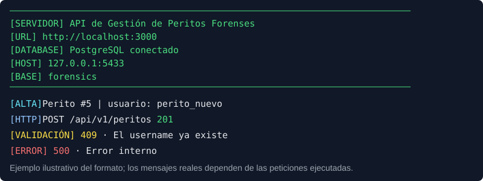

# API de Gestión de Peritos Forenses

Proyecto desarrollado para el examen parcial de Desarrollo de Sistemas Web Backend — IFTS N.º 16.

## Descripción

API REST desarrollada con Node.js, Express y Sequelize para gestionar usuarios peritos y sus roles.

Permite registrar peritos, consultar usuarios activos, filtrar por rol y realizar bajas lógicas sin eliminar físicamente los registros.

## Estructura del proyecto

```text
ifts16-api-peritos-forenses/
├── src/
│   ├── config/
│   │   └── database.js
│   ├── controllers/
│   │   └── peritos.controller.js
│   ├── middlewares/
│   │   └── errorHandler.js
│   ├── models/
│   │   ├── index.js
│   │   ├── role.js
│   │   └── user.js
│   ├── routes/
│   │   └── peritos.routes.js
│   ├── app.js
│   └── server.js
├── scripts/
│   └── seed.js
├── .env.example
├── .gitignore
├── compose.yaml
├── forensics.db
├── package.json
├── package-lock.json
├── consigna.md
└── README.md
```

## Instalación

Clonar el repositorio:

```bash
git clone https://github.com/ignaci0vidal/ifts16-i.vidal-api-peritos-forenses.git ifts16-api-peritos-forenses
cd ifts16-api-peritos-forenses
```

Instalar dependencias:

```bash
npm ci
```

Crear el archivo de configuración:

```powershell
Copy-Item .env.example .env
```

## Ejecución con SQLite

Configurar en `.env`:

```dotenv
PORT=3000
DB_DIALECT=sqlite
DB_STORAGE=./forensics.db
```

El servidor comprueba la conexión y crea las tablas faltantes antes de aceptar
solicitudes. SQLite aplica las claves foráneas en cada conexión.

Cargar los roles y los tres usuarios de prueba antes de iniciar la API
(también puede repetirse sin duplicar los datos):

```bash
npm run seed
```

`sync()` crea tablas faltantes, pero no carga roles ni usuarios ni modifica
restricciones de tablas existentes. Una base nueva necesita el seed para poder
registrar peritos con un rol válido.

Iniciar el servidor:

```bash
npm run dev
```

La API estará disponible en `http://localhost:3000`.

El archivo `forensics.db` contiene los registros iniciales requeridos para la demostración.

## Ejecución con PostgreSQL

Se requiere Docker Desktop instalado y en funcionamiento.

Configurar en `.env`:

```dotenv
DB_DIALECT=postgres
DB_HOST=127.0.0.1
DB_PORT=5433
DB_NAME=forensics
DB_USER=forense
DB_PASSWORD=CAMBIAR_PASSWORD
```

Asignar una contraseña local antes de iniciar el contenedor.

Iniciar PostgreSQL:

```bash
docker compose up -d
```

Crear las tablas y cargar los datos iniciales:

```bash
npm run seed
```

Iniciar la API:

```bash
npm run dev
```

**Nota:** si se habían definido variables `DB_*` directamente en la terminal, estas pueden tener prioridad sobre los valores de `.env`. Reiniciar la terminal permite evitar configuraciones anteriores.

## Endpoints

| Método | Endpoint                     | Descripción                |
| ------ | ---------------------------- | -------------------------- |
| POST   | `/api/v1/peritos`            | Registrar un perito        |
| GET    | `/api/v1/peritos`            | Listar peritos activos     |
| GET    | `/api/v1/peritos?role=ADMIN` | Filtrar por rol            |
| GET    | `/api/v1/peritos/:id`        | Consultar un perito activo |
| DELETE | `/api/v1/peritos/:id`        | Dar de baja lógicamente    |

### Ejemplo de creación

**POST** `/api/v1/peritos`

```json
{
  "username": "perito_nuevo",
  "role_id": 2
}
```

Respuesta esperada: `201 Created`.

### Códigos HTTP

- `200`: operación o consulta exitosa.
- `201`: usuario registrado.
- `400`: datos inválidos.
- `404`: usuario inexistente o inactivo.
- `409`: nombre de usuario duplicado.
- `500`: error interno del servidor.

## Modelo de datos

**roles:** `id`, `nombre_rol`.

Roles iniciales: `ADMIN`, `FORENSIC_INSPECTOR`, `AUDITOR`.

**users:** `id`, `username`, `role_id`, `active`, `created_at`.

Cada usuario pertenece a un rol mediante `role_id`, que funciona como clave foránea.

La baja lógica cambia `active` a `false`; los registros permanecen almacenados, pero se excluyen de las consultas de usuarios activos.

## Auditoría y errores

La presentación de los mensajes se centraliza en
[`src/utils/logger.js`](src/utils/logger.js), un módulo propio que utiliza Chalk
y se integra con Morgan. No requiere instalar dependencias adicionales.

- Etiquetas alineadas para identificar altas, bajas, validaciones y errores.
- Colores en etiquetas y códigos HTTP para destacar la información relevante.
- Morgan registra método, ruta y estado HTTP, sin hora ni duración.
- El banner de inicio aparece después de conectar y sincronizar la base: muestra
  la URL de la API y el motor conectado. Para SQLite indica el archivo; para
  PostgreSQL, el host, puerto y nombre de base, sin mostrar credenciales.
- Los errores internos muestran el mensaje principal y, debajo, las líneas del
  stack en rojo tenue, sin repetir el encabezado del error.

Chalk distingue los mensajes mediante colores:

- Cyan: registro exitoso de un usuario.
- Amarillo: errores de validación.
- Rojo: errores internos y stack.
- Verde: banner de inicio y estados HTTP exitosos.
- Azul: etiquetas HTTP y errores como 404.

En los registros de Morgan, los códigos 400 y 409 se muestran en amarillo;
los códigos 500 o superiores, en rojo; las redirecciones, en cyan.

### Ejemplo de consola



Imagen ilustrativa basada en el ejemplo de referencia. Los mensajes reales
dependen del motor seleccionado y de las peticiones ejecutadas.

El middleware centralizado devuelve respuestas HTTP en formato JSON.

## Desarrollado por

Ignacio Vidal — IFTS N.º 16.
